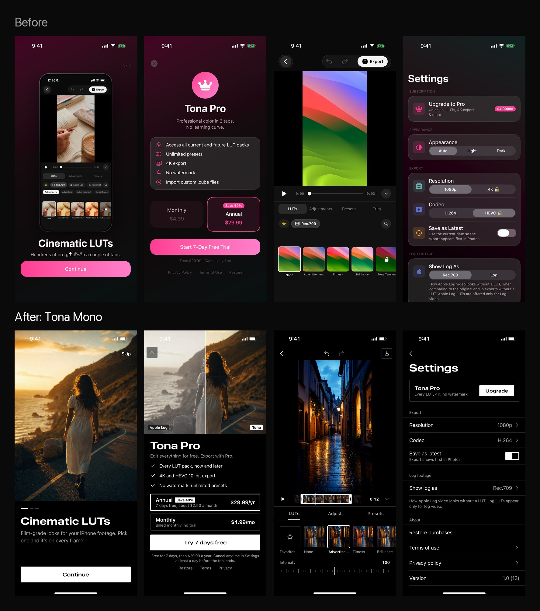

# /mobile-design: скилл Claude для дизайна мобильных приложений

Попроси Claude «красивый дизайн приложения», и получишь розовый градиент, стеклянные карточки,
кнопки-таблетки и корону на экране оплаты. Так выглядел мой Tona, пока я не собрал правила, по которым
его переделал. Этот скилл и есть эти правила.



## Что делает

1. Сначала понимает, ради чего экран: контент, одно главное действие, платформа.
2. Собирает маленькую строгую систему: цвета, шрифты, отступы, 3 радиуса. Экраны берут значения
   только оттуда.
3. Запрещает «нейросетевой» вид: градиенты, стекло, таблетки, иконки в кружках, короны, эмодзи,
   всё по центру.
4. Собирает экраны по рецептам: онбординг, оплата, пустой экран, галерея, настройки, редактор, шторка.
5. Перед показом гоняет каждый экран по чеклисту.

Работает для SwiftUI, React Native, Flutter, Compose. Если кода ещё нет, рисует HTML-макеты 402×874.

## Установка

Проще всего вставить в Claude Code:

```
Установи скилл https://github.com/vaykondev/mobile-design-skill в ~/.claude/skills
```

Или руками:

```bash
git clone https://github.com/vaykondev/mobile-design-skill /tmp/mobile-design-skill
cp -R /tmp/mobile-design-skill/skills/mobile-design ~/.claude/skills/
```

Перезапусти Claude Code, и команда `/mobile-design` появится.

## Как пользоваться

```
/mobile-design сделай экраны онбординга и оплаты для моего приложения
```

Для готового приложения:

```
/mobile-design переделай дизайн, функции не трогай
```

Без бренда скилл берёт характер Mono: чёрный, белый акцент, широкие заголовки. Если бренд есть,
его цвет становится единственным акцентом, а дисциплина остаётся та же.

## Что внутри

```
skills/mobile-design/
  SKILL.md                    порядок работы
  references/tokens.md        токены для SwiftUI, React Native, Flutter, Compose, HTML
  references/anti-patterns.md что Claude делает по умолчанию и чем заменить
  references/screens.md       рецепты экранов с размерами
  references/checklist.md     проверка перед показом
```

## Автор

Влад, разработчик, 9 лет. Строю свои продукты с AI у всех на глазах в Telegram: [@vaykord_dev](https://t.me/vaykord_dev).
Tona, приложение, из которого вырос скилл, строю там же.

MIT
